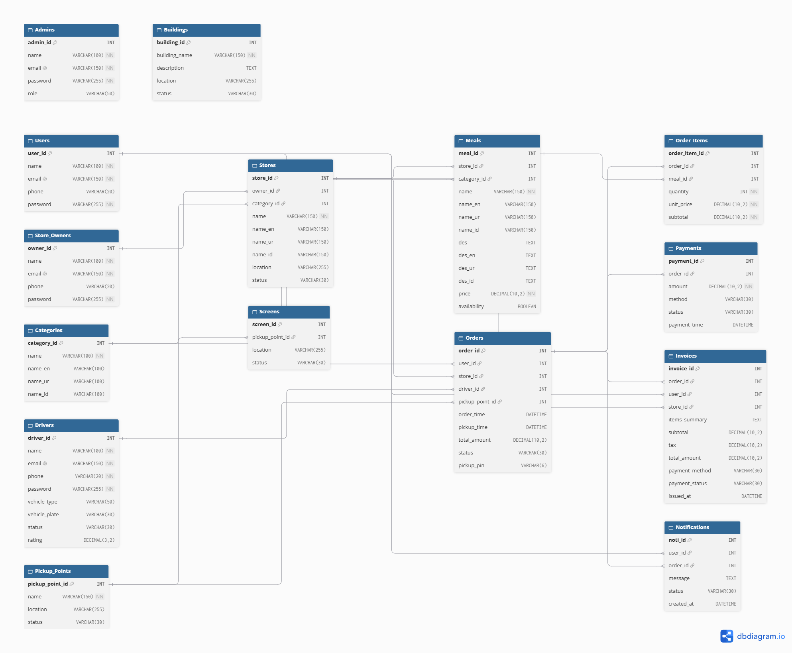

# مشروع دال (Dall) 🚀

نظام توصيل ذكي مخصص لخدمة ضيوف الرحمن في الحرم المكي الشريف.

## 📝 وصف المشروع
"دال" هو نظام متكامل يربط بين المطاعم، المقاهي، الصيدليات، ومحلات السوبر ماركت في المنطقة المركزية بمكة المكرمة، مع العملاء (الحجاج والزوار) والسائقين، بهدف تسهيل طلب الطعام والمستلزمات واستلامها بسرعة وسهولة.

## ✨ مميزات المشروع
*   دعم 4 لغات: العربية، الإنجليزية، الأردية، الإندونيسية.
*   4 واجهات مستخدم: عميل، صاحب متجر، سائق، ومدير النظام.
*   نظام نقاط استلام: 8 نقاط موزعة حول الحرم المكي.
*   أمان: تشفير كلمات المرور، وتوليد رقم PIN للاستلام.
*   تحديثات فورية: ربط الطلبات بالسائقين بشكل مباشر.

## 🛠️ التقنيات المستخدمة
*   الواجهات (Frontend): HTML, CSS, JavaScript, Flutter.
*   الخادم (Backend): Node.js, Express.js.
*   قاعدة البيانات: MySQL (16 جدولاً).
*   أدوات مساعدة: ngrok (للتجربة)، GitHub.

## 👥 فريق العمل
*   ريماس، شذى، لمار، ليلى، اليان، ريتاج.

## 📊 مخطط قاعدة البيانات (ERD)

*   كود التطبيق (Flutter): [تحميل من Google Drive](https://drive.google.com/file/d/13ePQrADghDh9Hqq3HqLn96cKlIIQVKgY/view?usp=sharing)
